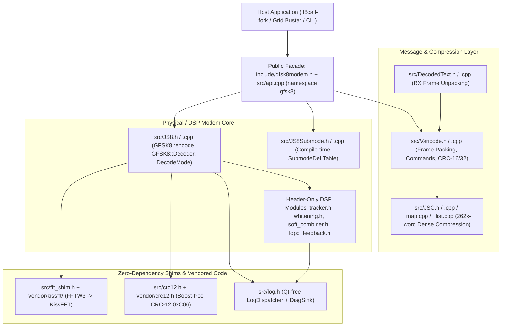

# Architecture & Codebase Map

`gfsk8-modem-clean-fork` is organized into four clean layers with zero external runtime dependencies.

---

## High-Level Layered Architecture

---

## Repository Directory & File Inventory

### Public Interface (`include/`)

| File | Responsibility |
|------|----------------|
| `include/gfsk8modem.h` | The sole public header exported by the `gfsk8modem` CMake target. Declares `gfsk8::Submode`, `SubmodeParms`, `TxFrame`, `Decoded`, `Decoder`, `submodeParms()`, `encode()`, `modulate()`, `pack()`, and `setLogCallback()`. |

### Core Library Sources (`src/`)

#### API & Shared State

| File | Compiled in `gfsk8modem` | Responsibility |
|------|--------------------------|----------------|
| `src/api.cpp` | Yes | Implements `include/gfsk8modem.h`; defines process globals `dec_data`, `specData`, `fftw_mutex`, and `gfsk8::g_logger`; computes UTC-aligned `kpos*`/`ksz*` windows and delegates decode to `GFSK8::Decoder`. |
| `src/commons.h` | Header | Defines core constants (`GFSK8_RX_SAMPLE_RATE = 12000`, `GFSK8_RX_SAMPLE_SIZE = 720000`, `GFSK8_NUM_SYMBOLS = 79`, per-submode macros), `RxAudioBuffer`, `RxSpectrum`, `code_time()`, and `decode_time()`. |
| `src/constants.h` | Header | Bridges `js8codec.cpp` macro/type aliases (`g_decodeData`, `g_fftMutex`, `g_specData`, `DecodeData`, `HourMinuteSecond`) onto `commons.h` globals. |
| `src/log.h` | Header | Defines `gfsk8::LogDispatcher`, `GFSK8_LOG(...)`, and zero-overhead no-op shims (`DiagSink`, `LogCategory`) replacing `qCDebug`/`qCWarning`/`qCInfo` and `Q_LOGGING_CATEGORY`. |

#### Modem Core & Submodes

| File | Compiled in `gfsk8modem` | Responsibility |
|------|--------------------------|----------------|
| `src/JS8.h`, `src/JS8.cpp` | Yes | **Active modem backend** used by `api.cpp`. Implements `GFSK8::Costas`, `GFSK8::encode`, `DecodeMode<ModeA/B/C/E/I>`, `bpdecode174`, `syncjs8`, `syncjs8d`, `baselinejs8`, `js8_downsample`, `subtractjs8`, `js8dec`, and `GFSK8::Decoder`. |
| `src/js8codec.h`, `src/js8codec.cpp` | Yes | Standalone refactored codec (`namespace gfsk8inner`) mirroring `JS8.cpp` with cleaner naming and condensed structure. Compiled into `libgfsk8modem.a` for library consumers/experimentation, though `api.cpp` currently instantiates `GFSK8::Decoder` from `JS8.cpp`. |
| `src/JS8Submode.h`, `src/JS8Submode.cpp` | Yes | Compile-time `SubmodeDef` table (`kNormal`, `kFast`, `kTurbo`, `kSlow`, `kUltra`) and `GFSK8::Submode::*` inquiry and cycle-math functions. |

#### Header-Only DSP Enhancements

| File | Responsibility |
|------|----------------|
| `src/tracker.h` | Header-only first-order exponential smoothers: `gfsk8::FrequencyTracker` (per-sample complex phase rotation) and `gfsk8::TimingTracker` (bounded fractional-sample offset tracking). |
| `src/FrequencyTracker.h`, `src/FrequencyTracker.cpp` | Redirect header to `tracker.h` and an empty stub `.cpp` (not listed in `CMakeLists.txt`). |
| `src/whitening.h` | Header-only `gfsk8::WhiteningProcessor<NROWS, ND, N>`: computes linear (`llr0`) and log (`llr1`) 8-FSK LLRs, estimates per-tone and per-symbol non-winning medians, applies noise whitening + erasure thresholding, and normalizes LLR variance (`std = 2.83`). |
| `src/whitening_processor.h` | Redirect header including `whitening.h`. |
| `src/soft_combiner.h` | Header-only `gfsk8::SoftCombiner<N>`: caches and vector-adds repeated LLR frames keyed by `(mode, 1 Hz bin, 100 ms dt bin)` and a 32-bit LLR sign signature matched within Hamming distance ≤ 4. |
| `src/ldpc_feedback.h` | Runtime env-variable configuration (`llrErasureThreshold`, `ldpcFeedbackEnabled`, `ldpcFeedbackMaxPasses`) and `refineLlrsWithLdpcFeedback<N>()` for multi-pass LDPC feedback. |

#### FFT & CRC Shims

| File | Responsibility |
|------|----------------|
| `src/fft_shim.h` | Maps the single-precision FFTW3 subset (`fftwf_complex`, `fftwf_plan_dft_1d`, `fftwf_plan_dft_r2c_1d`, `fftwf_execute`, `fftwf_destroy_plan`) onto KissFFT (`kiss_fft` / `kiss_fftr`). |
| `src/fftw_compat.h` | Redirect header including `fft_shim.h`. |
| `src/crc12.h` | Bit-at-a-time MSB-first CRC-12 (polynomial `0xC06`) matching `boost::augmented_crc<12, 0xc06>`. Identical algorithm to `vendor/crc12.h` (note: `src/` precedes `vendor/` in `target_include_directories`, so `#include "crc12.h"` resolves to `src/crc12.h`). |

#### Message Protocol & Compression Layer

| File | Compiled in `gfsk8modem` | Responsibility |
|------|--------------------------|----------------|
| `src/Varicode.h`, `src/Varicode.cpp` | Yes | Complete Qt-free JS8 Varicode codec: character escaping, Huffman table, callsign/grid/command packing, CRC-16/KERMIT, CRC-32/BZIP2, and `buildMessageFrames()`. |
| `src/DecodedText.h`, `src/DecodedText.cpp` | Yes | Unpacks a decoded 12-char physical payload into structured fields by trying five strategies in order: FastData, Data, Heartbeat, Compound, and Directed. |
| `src/JSC.h`, `src/JSC.cpp` | Yes | Variable-length `(s=7, c=9, b=4)` dense word compressor and decompressor with an in-memory lookup cache (`s_wordCache`). |
| `src/JSC_map.cpp`, `src/JSC_list.cpp` | Yes | Static 262,144-entry dictionary tables (`JSC::map`, `JSC::list`) and 103-entry first-character prefix index (`JSC::prefix`). |

### Vendored Dependencies (`vendor/`)

| Path | Responsibility |
|------|----------------|
| `vendor/kissfft/` | Vendored KissFFT (`kiss_fft.c/.h`, `kiss_fftr.c/.h`, `_kiss_fft_guts.h`, `kiss_fft_log.h`), built as static library `libkissfft.a` with `-Wall -Wextra` and patched for `CVE-2025-34297`. |
| `vendor/crc12.h` | Historical vendored CRC-12 header documenting the 2026-03-24 fix from `0x80F` to `0xC06`. |

### Tests & Utilities (`cpp_tests/`)

| File | Target Type | Purpose |
|------|-------------|---------|
| `cpp_tests/test_encode.cpp` | CTest (`encode`) | Verifies `encode()` / `modulate()` across all 5 submodes and runs `CVE-2025-34297` KissFFT allocator bounds regression tests. |
| `cpp_tests/test_loopback.cpp` | CTest (`loopback`) | End-to-end Normal-mode modulate → UTC-aligned snapshot → decode loopback test. |
| `cpp_tests/test_loopback_all.cpp` | CTest (`loopback_all`) | End-to-end `pack()` → `modulate()` → UTC-aligned snapshot → `Decoder::decode()` test across all 5 submodes. |
| `cpp_tests/test_decode_wav.cpp` | Standalone executable | Decodes a 12 kHz 16-bit mono PCM WAV file and prints raw + `DecodedText`-unpacked frames. |

---

## Internal Design Details

### Compile-Time Constants & Tables

To keep runtime initialization fast and deterministic while supporting both GCC and Clang under ISO C++20:

- **LDPC Generator Matrix (`parity`):** The 87×87 generator matrix is bit-packed at compile time from hex strings into `119 × uint64_t` (952 bytes).
- **BP Parity-Check Graph (`Mn`, `Nm`, `Nrw`):** Hard-coded `constexpr` adjacency lists for the `(174, 87)` PEG LDPC code (`3` checks per variable node, up to `7` variables per check node).
- **Baseline Chebyshev Nodes (`BASELINE_NODES`):** 6 Chebyshev nodes computed at compile time via a 16th-order minimax/Taylor cosine approximation (`cos_approx`), avoiding non-standard `constexpr` `<cmath>` calls.
- **Downsampling Tapers (`Taper`):** Fore and aft raised-cosine edge tapers (`Mode::NDD + 1` points) precomputed at compile time per submode.
- **Nuttall Window (`nuttal`):** Built in `DecodeMode()` using Kahan compensated summation to match the original Fortran floating-point precision.

### Decoder Memory & FFT Plan Lifecycle

Constructing a `gfsk8::Decoder` creates one `GFSK8::Decoder::Impl`, which holds a `std::array<DecodeEntry, 5>` containing **all five** `DecodeMode<Mode>` instantiations (`ModeI`, `ModeE`, `ModeC`, `ModeB`, `ModeA` — evaluated in that order during a decode pass), regardless of which bits are set in `submodes`.

Each `DecodeMode<Mode>` allocates 6 reusable KissFFT plans inside `FftPlanSet` under `fftw_mutex`:

| Plan Enum | Transform | Size | Buffer | Purpose |
|-----------|-----------|------|--------|---------|
| `Plan::DS` | C2C Backward | `Mode::NDFFT2` | `cd0` | Downsampled narrowband complex time-domain baseband. |
| `Plan::BB` | R2C Forward | `Mode::NDFFT1` | `ds_cx` | Full-period real-to-complex baseband spectrum (recomputed after each subtraction pass). |
| `Plan::CF` | C2C Forward | `Mode::NMAX` | `cfilt` | Forward FFT for complex envelope LPF during signal subtraction. |
| `Plan::CB` | C2C Backward | `Mode::NMAX` | `cfilt` | Inverse FFT for complex envelope LPF during signal subtraction. |
| `Plan::SD` | R2C Forward | `Mode::NFFT1` | `sd` | Quarter-symbol overlapping Nuttall-windowed spectra in `syncjs8`. |
| `Plan::CS` | C2C Forward | `Mode::NDOWNSPS` | `csymb` | Per-symbol 8-FSK tone magnitude extraction in `js8dec`. |

A temporary `Mode::NMAX` forward C2C plan is also created once in the constructor to pre-transform the Hann-squared subtraction filter (`NFILT = 1400`) into the frequency domain (`filter`), then destroyed immediately.

All plans are destroyed automatically when `FftPlanSet` goes out of scope (on `Decoder::~Decoder()` or `Decoder::reset()`). Because each `DecodeMode` also owns large aligned work arrays (`s[NSPS][NHSYM]`, `filter[NMAX]`, `cfilt[NMAX]`, `ds_cx`, `dd`), a `Decoder` object has a multi-megabyte heap footprint and must always be reused rather than constructed per decode cycle.
