# DSP & Protocol Specification

This document details the physical-layer wire format, submode timing/frequency constants, multi-pass receive DSP pipeline, and Varicode/JSC message-framing layer implemented by `gfsk8-modem-clean-fork`.

---

## Physical Layer Wire Format

### 1. 64-Character Physical Alphabet

Every physical-layer frame carries exactly **12 characters** drawn from a 64-symbol (6-bit) alphabet (`0..63`):

```text
Index 0..9   : 0123456789
Index 10..35 : ABCDEFGHIJKLMNOPQRSTUVWXYZ
Index 36..61 : abcdefghijklmnopqrstuvwxyz
Index 62..63 : -+
```

Spaces are **not** valid physical-layer characters; human-readable messages are first compressed and packed into this 64-symbol alphabet by `Varicode`.

### 2. 87-Bit Codeword Construction

`GFSK8::encode()` packs the 12-character message, 3-bit frame type, and 12-bit CRC into an 11-byte (88-bit) buffer where the first 87 bits form the LDPC information vector (`KK = 87`):

```text
Bit Offset   Width   Contents
----------   -----   ----------------------------------------------------
0..71        72 b    12 × 6-bit words (MSB-first, packed 4 chars / 3 bytes)
72..74        3 b    Frame type (lower 3 bits of TransmissionType)
75..86       12 b    Augmented CRC-12 XOR 42 (poly 0xC06, MSB-first)
87            1 b    Zero padding bit (included in 11-byte CRC input)
```

**CRC-12 specification (`src/crc12.h`):**

- Generator polynomial: `0xC06` ($x^{12} + x^{11} + x^{10} + x^2 + x$)
- Initial value: `0`, final XOR before JS8 mask: `0`, non-reflected MSB-first (matching `boost::augmented_crc<12, 0xc06>`).
- Computed over all 11 bytes with bits `75..87` zeroed, then XORed with `42` (`0x2A`) to distinguish JS8 frames from FT8 frames.

### 3. Systematic `(174, 87)` LDPC Encoding

The 87 information bits are multiplied modulo 2 by a fixed 87×87 Progressive Edge Growth (PEG) generator matrix (`parity`) to produce 87 parity-check bits (`M = 87`, total codeword length `N = 174`, code rate `R = 1/2`).

### 4. 79-Symbol 8-FSK Tone Frame

The 87 parity bits and 87 information bits are grouped into two blocks of 29 3-bit symbols (`ND = 58` data symbols, each mapped directly to tone `0..7`) and bracketed by three 7-symbol Costas synchronization arrays (`NS = 21`, total `NN = 79` symbols):

```text
Symbol Range   Count   Contents
------------   -----   ---------------------------------------
 0 ..  6         7     Costas Array A
 7 .. 35        29     LDPC Parity Symbols (87 bits -> 29 × 3b)
36 .. 42         7     Costas Array B
43 .. 71        29     Information + CRC Symbols (87 bits -> 29 × 3b)
72 .. 78         7     Costas Array C
```

**Costas Synchronization Sequences:**

- **`ORIGINAL`** (Normal / ModeA — identical to FT8):
  - Block A, B, C: `{4, 2, 5, 6, 1, 3, 0}`
- **`MODIFIED`** (Fast, Turbo, Slow, Ultra — distinct blocks prevent false half-frame sync):
  - Block A: `{0, 6, 2, 3, 5, 4, 1}`
  - Block B: `{1, 5, 0, 2, 3, 6, 4}`
  - Block C: `{2, 5, 0, 6, 4, 1, 3}`

### 5. Continuous-Phase 8-FSK Modulation

`gfsk8::modulate()` synthesizes audio at $f_s = 12{,}000\text{ Hz}$:

1. Prepends `round(startDelayMs * 12)` zero samples.
2. For each symbol $k \in [0, 78]$ with tone $t_k \in [0, 7]$, generates `samplesPerSymbol` samples at instantaneous frequency $f_k = f_{\text{carrier}} + t_k \cdot \Delta f$, advancing a continuous phase accumulator $\phi \in (-\pi, \pi]$ without phase discontinuities across symbol boundaries.

---

## Submode DSP Parameters

All values below are exact constants from `src/JS8.cpp` and `src/JS8Submode.cpp` at $f_s = 12{,}000\text{ Hz}$ (`NFOS = 2` frequency oversampling, `NSSY = 4` time steps per symbol):

| Parameter | ModeA (Normal) | ModeB (Fast) | ModeC (Turbo / JS8 40) | ModeE (Slow) | ModeI (Ultra / JS8 60) |
|-----------|----------------|--------------|------------------------|--------------|------------------------|
| `NSUBMODE` | `0` | `1` | `2` | `4` | `8` |
| `NCOSTAS` | `ORIGINAL` | `MODIFIED` | `MODIFIED` | `MODIFIED` | `MODIFIED` |
| `NSPS` (samples/sym) | 1920 | 1200 | 600 | 3840 | 384 |
| `NTXDUR` (period, s) | 15 | 10 | 6 | 30 | 4 |
| `ASTART` (start delay, s) | 0.5 | 0.2 | 0.1 | 0.5 | 0.1 |
| Tone spacing (baud, Hz) | 6.25 | 10.0 | 20.0 | 3.125 | 31.25 |
| Occupied bandwidth (`8 × baud`) | 50 Hz | 80 Hz | 160 Hz | 25 Hz | 250 Hz |
| Data duration (`79 × NSPS / fs`) | 12.64 s | 7.90 s | 3.95 s | 25.28 s | 2.528 s |
| Total TX duration (`+ ASTART`) | 13.14 s | 8.10 s | 4.05 s | 25.78 s | 2.628 s |
| `NMAX` (`NTXDUR × 12000`) | 180,000 | 120,000 | 72,000 | 360,000 | 48,000 |
| `NFFT1` (`NSPS × 2`) | 3840 | 2400 | 1200 | 7680 | 768 |
| `DF` (`12000 / NFFT1`, Hz) | 3.125 | 5.0 | 10.0 | 1.5625 | 15.625 |
| `NSTEP` (`NSPS / 4`) | 480 | 300 | 150 | 960 | 96 |
| `TSTEP` (`NSTEP / 12000`, s) | 0.040 | 0.025 | 0.0125 | 0.080 | 0.008 |
| `NHSYM` (`NMAX / NSTEP - 3`) | 372 | 397 | 477 | 372 | 497 |
| `JZ` (coarse DT search ±steps) | 62 (±2.48 s) | 144 (±3.60 s) | 172 (±2.15 s) | 32 (±2.56 s) | 250 (±2.00 s) |
| `NDOWNSPS` (downsampled sps) | 32 | 20 | 12 | 32 | 12 |
| `NDOWN` (`NSPS / NDOWNSPS`) | 60 | 60 | 50 | 120 | 32 |
| `FS2` (`12000 / NDOWN`, Hz) | 200 | 200 | 240 | 100 | 375 |
| `NDD` (FFT/taper factor) | 100 | 100 | 120 | 94 | 125 |
| `NDFFT1` (`NSPS × NDD`) | 192,000 | 120,000 | 72,000 | 360,960 | 48,000 |
| `NDFFT2` (`NDFFT1 / NDOWN`) | 3200 | 2000 | 1440 | 3008 | 1500 |
| `NP2` (`79 × NDOWNSPS`) | 2528 | 1580 | 948 | 2528 | 948 |
| `AZ` (candidate suppression, Hz) | 4.0 | 8.0 | 12.0 | 2.0 | 20.0 |
| `BASESUB` (SNR baseline offset) | 40.0 | 39.0 | 38.0 | 42.0 | 36.0 |
| Nominal RX SNR threshold | −24 dB | −22 dB | −20 dB | −28 dB | −18 dB |

---

## Receive (RX) DSP Pipeline

```mermaid
flowchart LR
    Audio["12 kHz int16 Window (dd)"] --> Sync["1. Coarse Sync (syncjs8 + baselinejs8)"]
    Sync --> BB["2. Baseband FFT (computeBasebandFFT)"]
    BB --> Cand["For each candidate (nfqso-first)"]
    Cand --> DS["3. Narrowband Downsample (js8_downsample)"]
    DS --> Fine["4. Fine Time/Freq Sync (syncjs8d)"]
    Fine --> Sym["5. Symbol FFT + Freq/Timing Trackers"]
    Sym --> Whiten["6. Noise Whitening & Dual LLR (WhiteningProcessor)"]
    Whiten --> Combine["7. LLR Soft Combining (SoftCombiner)"]
    Combine --> LDPC["8. BP LDPC + Feedback + CRC-12"]
    LDPC -- "Decoded (pass 1 & 2)" --> Sub["9. Signal Subtraction (subtractjs8)"]
    Sub --> Audio
```

When `Decoder::decode()` executes, `GFSK8::Decoder` iterates over enabled submodes in order (`ModeI` → `ModeE` → `ModeC` → `ModeB` → `ModeA`). For each enabled mode, `DecodeMode<Mode>::operator()` copies the UTC-aligned window `[kpos, kpos + ksz)` into `dd` (supporting ring-buffer wraparound) and runs up to **3 successive interference-cancellation passes**.



### Stage 1: Coarse Time/Frequency Sync & Noise Baseline (`syncjs8`, `baselinejs8`)

1. **Overlapping Symbol Spectra:** Steps through `dd` by quarter-symbol increments (`NSTEP`), applies a normalized 4-term Nuttall window (`a0=0.3635819, a1=-0.4891775, a2=0.1365995, a3=-0.0106411`), computes `NFFT1`-point real-to-complex FFTs, and populates power spectrogram `s[freq][time]` and average power `savg[freq]`.
2. **Chebyshev-Node Polynomial Baseline (`baselinejs8`):** Converts `savg` over `[500, 2500]` Hz to dB, evaluates the 10th-percentile lower envelope around 6 Chebyshev nodes (preventing Runge's phenomenon), solves the 6×6 Vandermonde system via Gaussian elimination with partial pivoting (zero Eigen dependency), and overwrites `savg[ia..ib]` using pairwise Estrin's polynomial evaluation (+0.65 dB offset).
3. **Costas Correlation:** For every frequency bin `i` in `[nfa, nfb]` (clamped to `[100, 4910]` Hz) and coarse time offset `j` in `[-JZ, +JZ]`, computes the ratio of energy on the Costas tones vs. off-Costas tones across all three blocks (`0..2`), the first two blocks (`0..1`), and the last two blocks (`1..2`), taking the maximum.
4. **40th-Percentile Normalization & Suppression:** Divides all peak sync metrics by the exact 40th percentile across the passband, sorts descending, accepts up to `NMAXCAND = 300` candidates with sync ≥ `ASYNCMIN` (`1.5`), and suppresses weaker neighbors within `±AZ Hz`.
5. **Priority Sorting:** Re-sorts accepted candidates to put signals within `< 10 Hz` of `nfqso` first, then by distance from `nfqso` and frequency.

### Stage 2: Baseband FFT & Narrowband Downsampling (`computeBasebandFFT`, `js8_downsample`)

1. Computes one full-window `NDFFT1`-point R2C FFT (`ds_cx`) per pass.
2. For each candidate `f0`, extracts the narrowband spectrum `[f0 - 1.5 baud, f0 + 8.5 baud]`, applies raised-cosine fore/aft tapers (`NDD + 1` bins), circularly shifts `f0` to DC, and runs an `NDFFT2`-point inverse C2C FFT into `cd0` (downsampled rate `FS2 = 12000 / NDOWN`).

### Stage 3: Fine Sync & Pilot-Driven Tracking (`syncjs8d`, `tracker.h`)

1. **Fine Time Search:** Correlates `cd0` against precomputed complex Costas symbol templates (`csyncs`) over `±NQSYMBOL` (`NDOWNSPS / 4`) downsampled steps.
2. **Fine Frequency Search:** Searches `delf ∈ [-2.5, +2.5]` Hz in `0.5` Hz steps (`NFSRCH = 5`), then rotates `cd0` by `-delfbest`.
3. **Per-Symbol Extraction & Tracking:** Iterates over all 79 symbols, running `NDOWNSPS`-point C2C FFTs (`csymb`) to extract 8-tone magnitudes `s2[0..7][0..78]`. On the 21 Costas pilot symbols:
   - **`FrequencyTracker`** estimates residual Hz via 3-bin parabolic peak interpolation around `expectedTone` (when peak-to-neighbor ratio ≥ `1.5`), smoothing with `alpha = 0.15`, `max_step = 0.3 Hz`, `max_error = 5.0 Hz`, and phase-rotating subsequent symbol slices.
   - **`TimingTracker`** measures early/late Goertzel energy at `i1 - 1`, `i1`, and `i1 + 1` samples, updating an exponential smoother (`alpha = 0.15`, `max_step = 0.35`, `max_total = clamp(0.08 * NDOWNSPS, 0.5, 2.0)` samples).
4. **Hard Costas Gate:** Counts how many of the 21 pilot positions have the expected Costas tone as their peak bin (`nsync`). Candidates with `nsync <= 6` are rejected before LDPC decoding.

### Stage 4: Noise Whitening & LLR Extraction (`WhiteningProcessor`)

Strips the 21 pilot symbols to form the `8 × 58` data magnitude matrix `s1` and computes two 174-element LLR arrays (3 bits per 8-FSK symbol via max-log demapping):

- `llr0`: Linear-magnitude max-log LLRs.
- `llr1`: Log-magnitude (`log(x + 1e-32)`) max-log LLRs.

When whitening is enabled (default), each symbol's 6 LLRs are divided by $\sqrt{\text{toneNoise}[w] \cdot \text{symbolNoise}[j] + 10^{-12}}$ where noise levels are medians of the non-winning tone bins. Values with $|\text{LLR}| < \text{erasureThreshold}$ (default `0.25`) are zeroed (erased), and both vectors are normalized to standard deviation `2.83`.

### Stage 5: Soft Combining (`SoftCombiner<174>`)

Repeated transmissions of the same weak frame can accumulate LLR energy across periods:

- **Key:** `(mode, round(freqHz), round(dt * 10), signature32)` — 1 Hz frequency buckets and 100 ms timing buckets.
- **32-Bit Signature:** Samples 32 strided bit indices (`(v + 37) % 174`) of `0.5 * (llr0 + llr1)` and records their sign bits.
- **Matching:** Within the same `(mode, freqBin, dtBin)` bucket, any cached entry whose signature is within **Hamming distance ≤ 4** is vector-summed with the incoming `llr0` and `llr1`.
- **Expiration & Cleanup:** Entries expire after `TTL = 2 × NTXDUR` seconds and are evicted immediately upon successful CRC-12 decode (`markDecoded`).

### Stage 6: Belief-Propagation LDPC Decoding & Feedback (`bpdecode174`, `ldpc_feedback.h`)

Runs up to 4 erasure-masking passes (`ipass = 1..4`) bounded by `m_maxLdpcPasses` (default `8`):

| Pass `ipass` | Input LLRs | Purpose |
|--------------|------------|---------|
| 1 | `llr0Combined` (linear) | Primary AWGN/Rayleigh decode. |
| 2 | `llr1Combined` (log-magnitude) | Resilient to impulse noise / QRN. |
| 3 | `llr0Combined` with bits `[0..24)` zeroed | Recovers frames truncated or interfered at the start. |
| 4 | `llr0Combined` with bits `[24..48)` zeroed | Recovers frames hit by mid-frame burst interference. |

Each attempt runs standard log-domain sum-product belief propagation (`bpdecode174`, up to `BP_MAX_ITER = 30` iterations, `tanh`/`atanh` check-node updates with clamping at `±0.999999`).

If an attempt fails and `GFSK8_LDPC_FEEDBACK` is enabled (default), `refineLlrsWithLdpcFeedback()` updates the LLRs from the candidate codeword `cw`:
- Bits agreeing in sign with $|\text{LLR}| \ge 3.0$ are boosted by `1.2×` (capped at `6.0`).
- Bits disagreeing in sign or with $|\text{LLR}| \le 1.0$ are shrunk by `0.5×` (and zeroed if below `erasureThreshold`).
A second `bpdecode174` attempt is then executed on the refined LLRs.

**Validation gates for a valid decode:**
1. Non-zero codeword (`cw` is not all zeros).
2. `0 <= nharderrors < 60`, and not `(sync < 2.0 && nharderrors > 35)`, not `(ipass > 2 && nharderrors > 39)`, not `(ipass == 4 && nharderrors > 30)`.
3. `checkCRC12(decoded)` succeeds.

### Stage 7: Signal Subtraction (`genjs8refsig`, `subtractjs8`)

On passes 1 and 2 (`ipass < 3`), every successfully decoded frame is re-encoded into 79 tones, synthesized into a complex reference waveform `cref(t)` at frequency `f1`, and subtracted from `dd(t)`:

1. Mixes `dd(t) * conj(cref(t))` aligned at `xdt2`.
2. Low-pass filters the complex envelope in the frequency domain using the precomputed `NFILT = 1400` Hann-squared kernel (`Plan::CF` → multiply by `filter` → `Plan::CB`).
3. Subtracts `2 * real(cfilt(t) * cref(t))` from `dd(t)`.

If a pass yields at least one new or higher-SNR decode, the decoder loops to the next pass, recomputing `syncjs8` and `computeBasebandFFT` to uncover weaker overlapping signals hidden underneath stronger ones.

---

## Message Framing & Compression (`Varicode`, `JSC`, `DecodedText`)

### Frame Types (3-Bit Embedded Header)

Inside the 72-bit payload, non-fast-data frames start with a 3-bit `Varicode::FrameType`:

| `FrameType` | Bits | Meaning |
|-------------|------|---------|
| `FrameHeartbeat` (`0`) | `000` | Heartbeat or CQ frame (`CALL: @HB HEARTBEAT GRID` or `CALL: @ALLCALL CQ ...`). |
| `FrameCompound` (`1`) | `001` | Compound callsign / grid announcement (`CALL/P:`). |
| `FrameCompoundDirected` (`2`) | `010` | Directed message addressing a compound callsign. |
| `FrameDirected` (`3`) | `011` | Standard directed frame (`FROM: TO CMD [NUM]`), supporting 32 built-in commands (`SNR?`, `GRID?`, `INFO?`, `STATUS?`, `HEARING?`, `MSG`, `MSG TO:`, `QUERY`, `ACK`, `NACK`, `HEARTBEAT SNR`, etc.). |
| `FrameData` (`4`) | `10X` | Free-text data frame (2-bit prefix; 70 bits of payload). |
| `FrameDataCompressed` (`6`) | `11X` | JSC-compressed data frame (2-bit prefix; 70 bits of payload). |

For non-Normal submodes (`Fast`, `Turbo`, `Slow`, `Ultra`), `Varicode::buildMessageFrames()` emits raw `JS8CallData` (`frameType |= 4`) fast-data frames that omit the embedded frame-type header and use all 72 payload bits for JSC/Huffman data.

### JSC `(s, c)`-Dense Word Compression

`JSC` (`src/JSC.cpp`, `JSC_map.cpp`, `JSC_list.cpp`) compresses common English/amateur-radio words using a 262,144-entry dictionary encoded in 4-bit nibbles (`b = 4`, stop values `s = 7` [`0..6`], continuation values `c = 9` [`7..15`]) with a 1-bit trailing-space flag appended after each leaf nibble. Words not in the dictionary fall back to shorter prefixes or single-character entries.

### Directed-Command Checksums

For buffered directed commands with trailing payload text (except when addressed to `@APRSIS`), `Varicode::buildMessageFrames()` appends an integrity checksum:
- **CRC-16/KERMIT** (`poly=0x1021`, `init=0x0000`, reflected) for 16-bit checksummed commands.
- **CRC-32/BZIP2** (`poly=0x04C11DB7`, `init=0xFFFFFFFF`, non-reflected, `xorout=0xFFFFFFFF`) for 32-bit checksummed commands.
